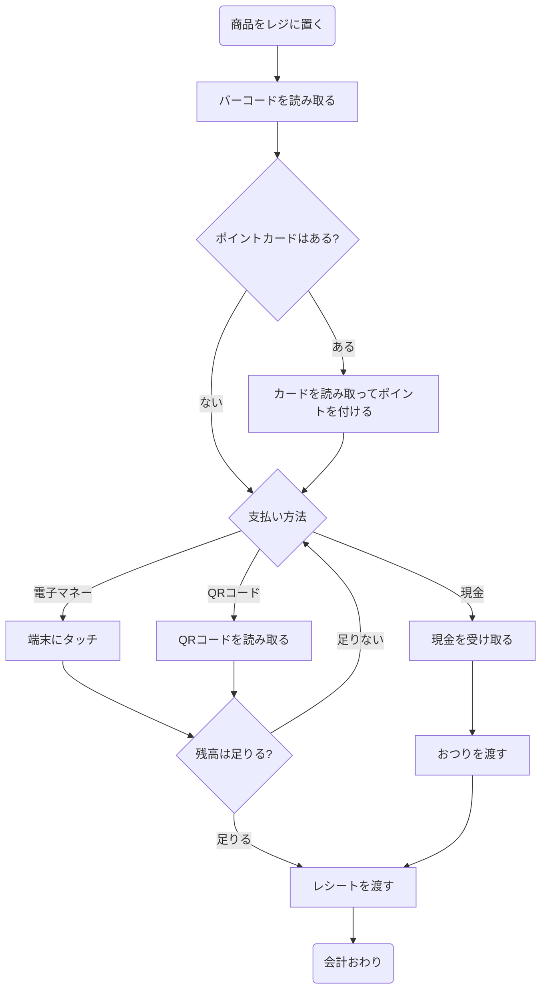
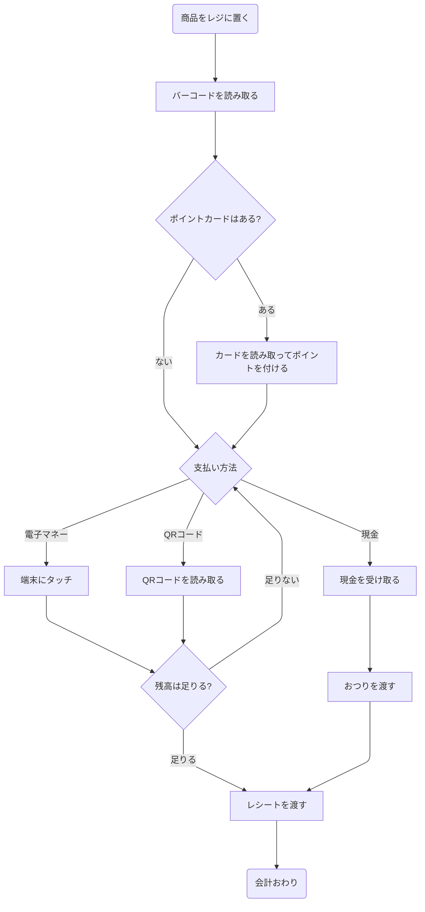

# Mermaid 11系と12系の比較で使ったフローチャート

記事「[Mermaid 12で図の見た目が変わった。日本語のラベルは折り返しに注意](https://catnipglitch.dev/mermaid-v11-v12-diff/)」で比べたフローチャートを、Mermaid のコードのまま置いています。このページを GitHub で開くと、GitHub の Mermaid で描かれた図が見られます。

記事の画像は、Mermaid CLI 11.17.1（本体 11.17.2）と 12.2.0（本体 12.3.0）で描いた SVG です。GitHub は配色のテーマを `default`（ダークモードでは `dark`）にして描くので、ここで見える図は CLI の 12 系の既定（`redux-color`）とは色が違います。配置と線の形、折り返しは GitHub の Mermaid の版に従います。

## 既定のまま

設定を何も書かない図です。

## 前の見た目の 3 行

テーマ・look・配置を 11 系の既定に戻します。12 系では、折り返し幅は戻りません。

## 3 行と折り返し幅 200

3 行に `wrappingWidth: 200` を足すと、11 系と同じ折り返しになります。

## 折り返し幅 200 だけ

新しい見た目のまま、折り返し幅だけを戻します。

## 余白が欲しいとき

配置を Dagre にして、線を角丸にし、間隔を指定します。12 系の既定の ELK では、`nodeSpacing` と `rankSpacing` が効きません（[mermaid-js/mermaid#7930](https://github.com/mermaid-js/mermaid/issues/7930)）。

## このフォルダについて

記事の公開時点のスナップショットです。公開後は更新しません。GitHub の Mermaid の版が上がると、同じコードでも見た目が変わることがあります。
